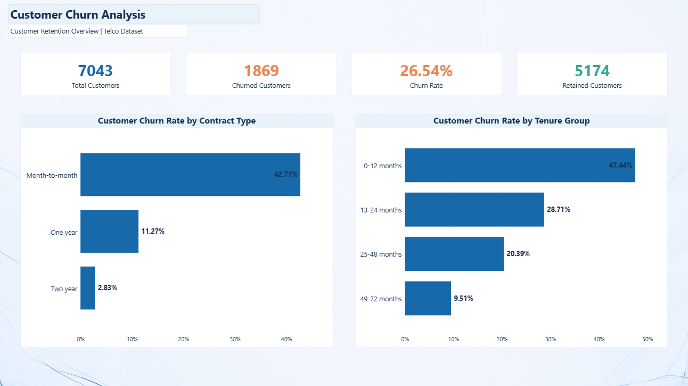
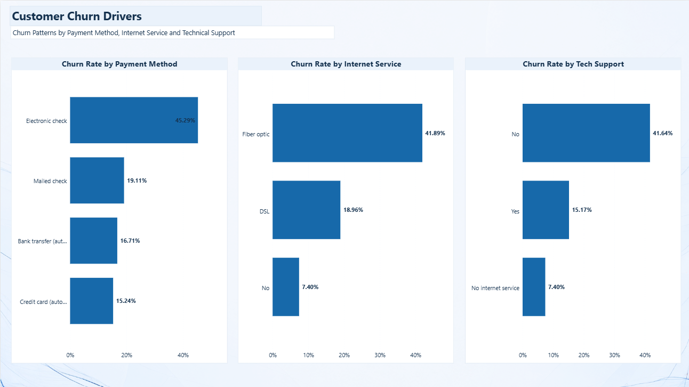

# Customer Churn Analysis

## Project Overview

This project analyzes customer churn in a telecommunications company to identify customer segments associated with higher churn rates and provide actionable insights to support customer retention.

The project follows an end-to-end data analysis workflow, from data preparation and exploratory data analysis to SQL investigation and interactive dashboard development using Python, MySQL, and Power BI.

## Business Objectives

- Measure the overall customer churn rate.
- Analyze churn patterns across contract types and customer tenure groups.
- Investigate churn by payment method, internet service, and technical support availability.
- Identify customer segments that may require targeted retention strategies.
- Communicate findings through an interactive Power BI dashboard.

## Tools and Technologies

- **Python:** Data preparation, exploratory data analysis, and visualization.
- **Pandas:** Data cleaning and manipulation.
- **MySQL:** SQL queries, aggregations, and customer segmentation.
- **Power BI:** KPI reporting and interactive dashboard visualization.
- **Jupyter Notebook:** Documentation and execution of the Python analysis.

## Dataset

The project uses the Telco Customer Churn dataset, containing 7,043 customer records and 21 columns describing customer demographics, subscribed services, account information, tenure, charges, and churn status.

Two dataset files are included:

- `data/Telco-Customer-Churn.csv` — Original dataset.
- `data/Telco-Customer-Churn-Fixed.csv` — Prepared dataset used for analysis in Power BI.

During data preparation, 11 blank `TotalCharges` values were identified for customers with zero tenure. These values were converted to zero in the prepared dataset, while the original dataset was preserved.

The target variable is `Churn`. Key fields include `customerID`, `tenure`, `Contract`, `PaymentMethod`, `InternetService`, `TechSupport`, `MonthlyCharges`, and `TotalCharges`.

## Methodology

### 1. Data Preparation and Exploratory Data Analysis

Using Python and Pandas, the analysis included:

- Inspecting dataset structure and data types.
- Identifying and handling missing values.
- Preparing numeric fields for analysis.
- Exploring customer characteristics and churn patterns.
- Summarizing findings and potential business implications.

### 2. SQL Analysis with MySQL

SQL queries were used to investigate churn across different customer segments, including:

- Churn rate by contract type.
- Churn rate by payment method.
- Churn rate by tenure group.
- Churn rate by internet service.
- Churn rate by technical support availability.
- Overall customer, churned customer, and retained customer counts.

### 3. Power BI Dashboard

The Power BI report contains two pages.

**Page 1 — Customer Retention Overview**

- Total Customers
- Churned Customers
- Retained Customers
- Overall Churn Rate
- Churn Rate by Contract Type
- Churn Rate by Tenure Group

**Page 2 — Customer Churn Drivers**

- Churn Rate by Payment Method
- Churn Rate by Internet Service
- Churn Rate by Tech Support

## Key Findings

### Overall Customer Churn

- **Total customers:** 7,043
- **Churned customers:** 1,869
- **Retained customers:** 5,174
- **Overall churn rate:** 26.54%

### Churn by Contract Type

| Contract Type | Churn Rate |
|---|---:|
| Month-to-month | 42.71% |
| One year | 11.27% |
| Two year | 2.83% |

Month-to-month customers show a substantially higher churn rate than customers with longer-term contracts.

### Churn by Payment Method

| Payment Method | Churn Rate |
|---|---:|
| Electronic check | 45.29% |
| Mailed check | 19.11% |
| Bank transfer (automatic) | 16.71% |
| Credit card (automatic) | 15.24% |

Electronic-check users have the highest churn rate among the payment method groups analyzed.

### Churn by Tenure Group

| Tenure Group | Churn Rate |
|---|---:|
| 0–12 months | 47.44% |
| 13–24 months | 28.71% |
| 25–48 months | 20.39% |
| 49–72 months | 9.51% |

Customers in their first year have the highest churn rate, highlighting the importance of early customer engagement and onboarding.

### Churn by Internet Service

| Internet Service | Churn Rate |
|---|---:|
| Fiber optic | 41.89% |
| DSL | 18.96% |
| No internet service | 7.40% |

Fiber-optic customers show a higher churn rate than the other internet service groups.

### Churn by Technical Support

| Technical Support | Churn Rate |
|---|---:|
| No | 41.64% |
| Yes | 15.17% |
| No internet service | 7.40% |

Customers without technical support have a higher churn rate than customers with support.

## Business Recommendations

1. **Improve customer onboarding:** Develop early engagement initiatives for customers in their first 12 months.
2. **Strengthen retention strategies:** Investigate retention offers and longer-term contract options for month-to-month customers.
3. **Investigate electronic-check churn:** Explore possible payment experience, pricing, or customer satisfaction issues among electronic-check users.
4. **Review fiber-optic customer experience:** Investigate service quality, pricing, and customer expectations within this segment.
5. **Promote technical support:** Make support options more accessible and evaluate their relationship with customer retention.
6. **Monitor churn KPIs:** Track churn rate and customer retention over time to evaluate future retention initiatives.

These recommendations are based on observed patterns. Further investigation or controlled experiments would be needed to establish whether specific interventions reduce churn.

## Dashboard Screenshots

### 1. Customer Retention Overview



This page presents the main customer KPIs and compares churn rates across contract types and tenure groups.

### 2. Customer Churn Drivers



This page compares churn rates by payment method, internet service, and technical support availability.

## Project Structure

```text
Customer_Churn_Analysis/
├── data/
│   ├── Telco-Customer-Churn.csv
│   └── Telco-Customer-Churn-Fixed.csv
├── screenshots/
│   ├── customer_retention_overview.png
│   └── customer_churn_drivers.png
├── Customer_Churn_Analysis.ipynb
├── Customer_Churn_Analysis.sql
├── Customer_Churn_Analysis_PowerBI.pbix
└── README.md
```

## Limitations

- This is a descriptive analysis of the available dataset.
- Associations between customer characteristics and churn do not establish causation.
- Further analysis would be needed to test retention interventions and evaluate their impact.
- The dataset may not represent current customer behavior.

## Conclusion

This project demonstrates an end-to-end data analysis workflow using Python, MySQL, and Power BI. By combining data preparation, exploratory analysis, SQL queries, and dashboard reporting, the project identifies customer segments with higher churn rates and presents findings that can support further customer retention analysis.
